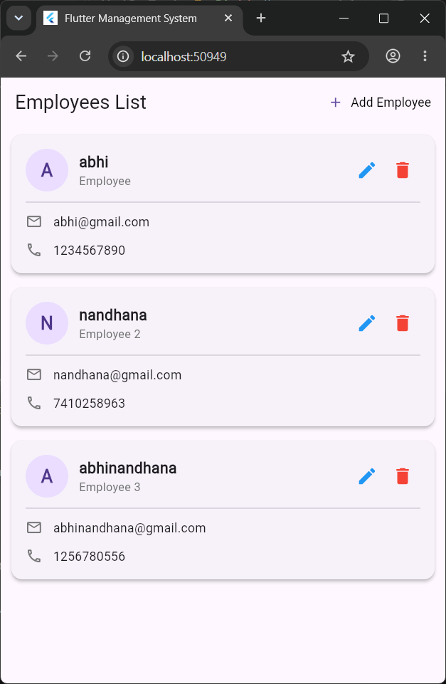
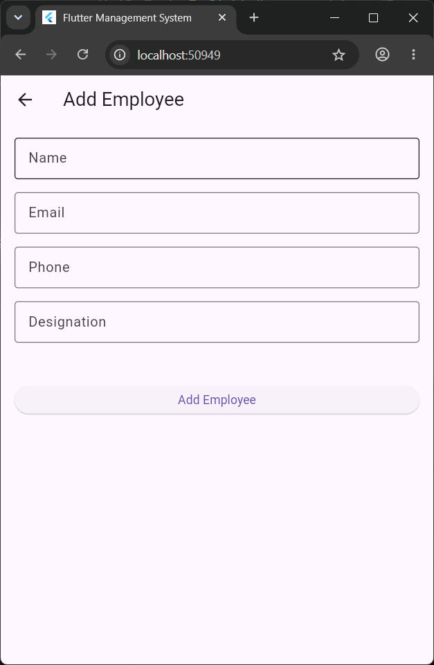
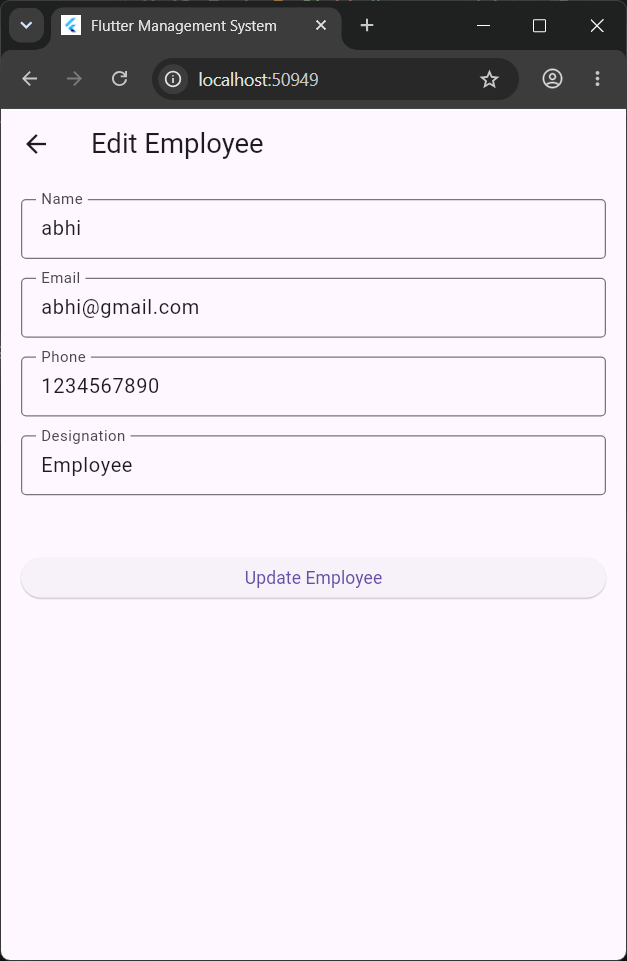

# Employees – Employee Management App

A Flutter-based Employee Management Application that allows users to manage employee records with a simple and user-friendly interface.

Built using Flutter, Dart, BLoC, Clean Architecture and Hive Database.

## Screenshots
  

## Features

- View Employees: Display all employee records.
- Add Employee: Add new employees with their details.
- Edit Employee: Update existing employee information.
- Delete Employee: Remove employee records with a confirmation dialog.
- Local Storage: Store employee information using Hive database.
- State Management: Manage application states using Flutter BLoC.

## Technologies Used

- Flutter & Dart
- BLoC – State Management
- Hive – Local Database
- GetIt – Dependency Injection
- Clean Architecture

## Architecture
The project follows Clean Architecture principles to separate application responsibilities.

```
lib/
├── core/
│   ├── database/
│   │   └── database_helper.dart
│   └── di/
│       └── injection.dart
│
└── features/
    └── employees/
        ├── data/
        │   ├── models/
        │   └── repositories/
        │
        ├── domain/
        │   ├── entities/
        │   └── repositories/
        │
        └── presentation/
            ├── bloc/
            ├── screens/
            └── widgets/
```
